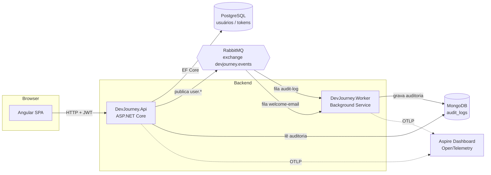

# 🚀 DevJourney

Projeto de estudo **evolutivo** para praticar as tecnologias mais atuais do mercado. Cada etapa da jornada
adiciona conceitos novos sobre esta mesma base. O objetivo é didático: uma prova de conceito **funcional**
e comentada, para ler, executar, quebrar e evoluir.

> **Etapa 1 — CRUD de usuários** com Angular + .NET, Clean Architecture, SOLID, autenticação JWT com refresh
> token, PostgreSQL + MongoDB, mensageria com RabbitMQ, observabilidade com OpenTelemetry e testes unitários.

---

## 🧱 Stack

| Camada | Tecnologia | Para quê |
|---|---|---|
| Front-end | **Angular 22** (standalone, Signals, zoneless, `rxResource`) | Telas de login, cadastro, CRUD e auditoria |
| Back-end | **.NET 10** / ASP.NET Core | API REST em camadas (Clean Architecture) |
| Banco relacional | **PostgreSQL 17** + **EF Core 10** (migrations) | Usuários e refresh tokens (dados transacionais) |
| Banco NoSQL | **MongoDB 8** | Logs de auditoria (documentos flexíveis, alto volume de escrita) |
| Mensageria | **RabbitMQ 4** (exchange *topic*, DLQ, ack manual) | Eventos de domínio processados de forma assíncrona |
| Segurança | **JWT** (access token) + **refresh token rotativo** em cookie HttpOnly, PBKDF2, rate limiting, políticas por perfil | Autenticação e autorização |
| Observabilidade | **OpenTelemetry** (traces, métricas e logs) + **.NET Aspire Dashboard** | Ver o caminho de cada requisição entre os serviços |
| Testes | **xUnit**, **NSubstitute**, **Shouldly** (back) · **Vitest** (front) | Testes unitários |
| Documentação da API | **OpenAPI** + **Scalar** | Testar endpoints pelo navegador |
| Infra local / CI | **Docker Compose** · **GitHub Actions** | Subir tudo com um comando; build e testes a cada push |

---

## 🗺️ Arquitetura



### Camadas do back-end (Clean Architecture)

```
backend/
├── src/
│   ├── DevJourney.Domain          ← Regras de negócio puras. Não depende de NADA.
│   ├── DevJourney.Application     ← Casos de uso + interfaces (portas). Depende só do Domain.
│   ├── DevJourney.Infrastructure  ← Implementações: EF Core, MongoDB, RabbitMQ, JWT, OpenTelemetry.
│   ├── DevJourney.Api             ← Controllers, autenticação, middlewares (composition root).
│   └── DevJourney.Worker          ← Consumidores de mensagens (processo separado).
└── tests/
    └── DevJourney.UnitTests       ← Testes de Domain, Application e Infrastructure.
```

A regra de ouro: **as dependências apontam sempre para dentro**. O domínio não sabe que existe banco, HTTP
ou RabbitMQ. Detalhes completos (incluindo onde cada princípio SOLID aparece no código) em
[`docs/ARQUITETURA.md`](docs/ARQUITETURA.md).

---

## ▶️ Como executar

### Pré-requisitos
- [Docker Desktop](https://www.docker.com/products/docker-desktop/) (ou Docker Engine + Compose)
- Para rodar fora do Docker: [.NET SDK 10](https://dotnet.microsoft.com/download) e [Node.js 24](https://nodejs.org/)

### Opção 1 — Tudo no Docker (mais simples)

```bash
docker compose up -d --build
```

### Opção 2 — Infra no Docker, aplicações na sua máquina (melhor para estudar/debugar)

```bash
# 1. Infraestrutura
docker compose up -d postgres mongo rabbitmq aspire-dashboard

# 2. API (aplica as migrations e cria o admin automaticamente)
cd backend
dotnet run --project src/DevJourney.Api

# 3. Worker (em outro terminal)
dotnet run --project src/DevJourney.Worker

# 4. Front-end (em outro terminal)
cd frontend
npm install
npm start
```

### 🔗 Endereços

| O quê | URL | Credenciais |
|---|---|---|
| Aplicação Angular | http://localhost:4200 | `admin@devjourney.local` / `Admin@123` |
| Documentação da API (Scalar) | http://localhost:5000/scalar | use o token do login |
| Health check | http://localhost:5000/health/ready | — |
| **Observabilidade** (Aspire Dashboard) | http://localhost:18888 | — |
| RabbitMQ Management | http://localhost:15672 | `guest` / `guest` |
| PostgreSQL | `localhost:5432` | `devjourney` / `devjourney` |
| MongoDB | `mongodb://localhost:27017` | — |

### 🧪 Testes

```bash
cd backend && dotnet test        # 45 testes unitários
cd frontend && npm test          # testes do Angular (Vitest)
```

---

## 🔐 Segurança — o que foi implementado e por quê

| Prática | Onde | Por quê |
|---|---|---|
| **Access token JWT** curto (15 min), assinado com HMAC-SHA256 | `Infrastructure/Security/JwtTokenService.cs` | API *stateless*; se vazar, expira rápido |
| **Refresh token opaco** com **rotação** | `Application/Auth/AuthService.cs` | Cada uso gera um novo token e invalida o anterior |
| **Detecção de reutilização** de refresh token | `AuthService.RefreshAsync` | Token antigo reapresentado = possível roubo → todas as sessões do usuário são revogadas |
| Refresh token salvo **apenas como hash SHA-256** | `RefreshToken.TokenHash` | Vazamento do banco não permite sequestrar sessões |
| Refresh token em **cookie HttpOnly + Secure + SameSite=Strict** | `Api/Security/RefreshTokenCookie.cs` | Inacessível a JavaScript (XSS) e não enviado por outros sites (CSRF) |
| Access token **só em memória** no Angular | `core/auth/auth.service.ts` | Nada sensível em `localStorage` |
| Senhas com **PBKDF2 + salt** (ASP.NET Identity) | `Infrastructure/Security/PasswordHasher.cs` | Hash lento e resistente a força bruta |
| **Política de senha forte** (front e back) | `Application/Users/UserValidators.cs` | — |
| **Autorização por perfil** (`AdminOnly`) + regras de negócio ("só edito meu cadastro") | `UsersController`, `UserService` | Defesa em profundidade: o guard do Angular é só UX |
| **Rate limiting** nos endpoints de autenticação | `Program.cs` | Mitiga força bruta |
| Mensagem genérica no login | `AuthService.LoginAsync` | Evita *user enumeration* |
| **Security headers** (CSP, nosniff, X-Frame-Options...) | `SecurityHeadersMiddleware.cs`, `nginx.conf` | Recomendações OWASP |
| **Problem Details** sem stack trace | `GlobalExceptionHandler.cs` | Não vaza detalhes internos |
| Configuração validada no startup | `JwtOptions` + `ValidateOnStart` | Falha cedo se a chave JWT for fraca |

> **E o OAuth2?** O fluxo implementado segue os conceitos do OAuth2 (bearer token, access + refresh token,
> rotação). Em uma próxima etapa da jornada vamos delegar a emissão dos tokens a um **Identity Provider**
> (Keycloak ou OpenIddict) com *Authorization Code + PKCE* e login social — ver [`docs/ROADMAP.md`](docs/ROADMAP.md).

---

## 📨 Mensageria — como funciona

1. A API salva o usuário no PostgreSQL e **publica** o evento `user.created` na exchange
   `devjourney.events` (tipo *topic*). Ela **não sabe** quem vai consumir.
2. O RabbitMQ roteia a mensagem para todas as filas cujo *binding* combina com a routing key:
   - `devjourney.audit-log` (binding `user.*`) → recebe **todos** os eventos de usuário;
   - `devjourney.welcome-email` (binding `user.created`) → recebe **apenas** criações.
3. O **Worker** consome cada fila, processa e confirma (**ack**). Em caso de erro, faz **nack** e a mensagem vai
   para a *Dead Letter Queue* (`<fila>.dlq`) em vez de ficar em loop.
4. O consumidor de auditoria grava no MongoDB usando o `EventId` como `_id` → processamento **idempotente**
   (receber a mesma mensagem duas vezes não duplica o registro).

Experimente: pare o Worker (`docker compose stop worker`), crie usuários e veja as mensagens acumulando na UI do
RabbitMQ. Ao religar o Worker, elas são processadas. Isso é **desacoplamento temporal**.

## 🔭 Observabilidade — como visualizar

Abra o **Aspire Dashboard** em http://localhost:18888 e use a aplicação:

- **Traces**: clique em um `POST api/users`. Você verá **um único trace** que atravessa
  API → PostgreSQL → RabbitMQ (*publish*) → Worker (*process*) → MongoDB. O contexto é propagado no header
  `traceparent` da mensagem (`Infrastructure/Messaging/MessagingTelemetry.cs`).
- **Structured logs**: logs das duas aplicações, filtráveis e ligados ao trace correspondente.
- **Metrics**: métricas de HTTP, runtime .NET e métricas customizadas:
  `devjourney.auth.logins` (por resultado), `devjourney.messages.published/consumed/failed`.

Como tudo usa o protocolo aberto **OTLP**, basta trocar a variável `OTEL_EXPORTER_OTLP_ENDPOINT` para enviar os
dados para Grafana Cloud, Jaeger, Honeycomb, Datadog etc.

---

## ☁️ Rodando com serviços gratuitos na nuvem

O acesso a dados foi feito da forma mais simples possível: basta trocar as *connection strings*
(por variáveis de ambiente ou `appsettings.json`).

| Recurso | Serviço gratuito sugerido | Configuração |
|---|---|---|
| PostgreSQL | [Neon](https://neon.tech) ou [Supabase](https://supabase.com) | `ConnectionStrings__Postgres` |
| MongoDB | [MongoDB Atlas](https://www.mongodb.com/atlas) (cluster M0) | `Mongo__ConnectionString` (`mongodb+srv://...`) |
| RabbitMQ | [CloudAMQP](https://www.cloudamqp.com) (plano Little Lemur) | `RabbitMq__Uri` (`amqps://...`) |
| Observabilidade | [Grafana Cloud](https://grafana.com/products/cloud/) (free tier, OTLP) | `OTEL_EXPORTER_OTLP_ENDPOINT` + `OTEL_EXPORTER_OTLP_HEADERS` |

> ⚠️ Nunca faça commit de credenciais reais. Use variáveis de ambiente, `dotnet user-secrets` ou o secret manager
> da plataforma. Troque também `Jwt:SigningKey` e `Seed:AdminPassword` fora do ambiente local.

---

## 🧭 Próximos passos da jornada

Veja [`docs/ROADMAP.md`](docs/ROADMAP.md). Spoiler: Transactional Outbox, testes de integração com
Testcontainers, Keycloak/OAuth2 + PKCE, cache com Redis, Kafka, Kubernetes, deploy na nuvem...
