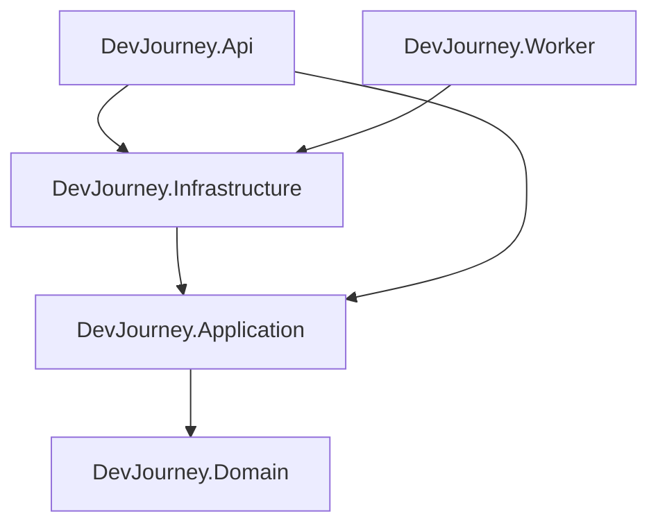
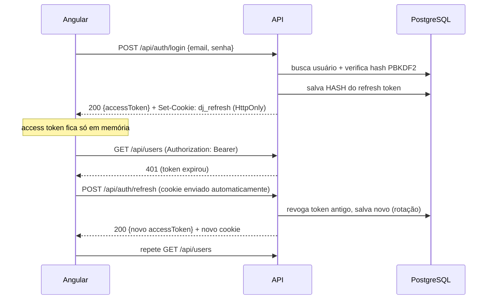
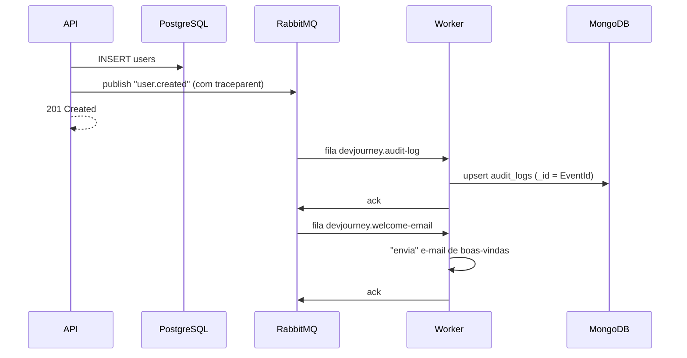

# Arquitetura do DevJourney

## 1. Clean Architecture em camadas

| Projeto | Responsabilidade | Exemplos |
|---|---|---|
| **Domain** | Entidades, Value Objects e invariantes de negócio. Zero dependências externas. | `User`, `Email`, `RefreshToken`, `DomainException` |
| **Application** | Casos de uso (orquestração) e as **interfaces** de que precisa (portas). Validação de entrada. | `UserService`, `AuthService`, `IUserRepository`, `IEventPublisher`, `Result<T>` |
| **Infrastructure** | **Adaptadores** que implementam as portas usando tecnologias concretas. | `UserRepository` (EF Core), `MongoAuditLogStore`, `RabbitMqEventPublisher`, `JwtTokenService` |
| **Api** | Entrada HTTP: controllers finos, autenticação, autorização, middlewares, DI. | `UsersController`, `Program.cs`, `GlobalExceptionHandler` |
| **Worker** | Entrada por mensagens: consumidores RabbitMQ. | `AuditLogConsumer`, `WelcomeEmailConsumer` |

Benefícios práticos:
- Trocar PostgreSQL por SQL Server = mudar **uma linha** (`UseNpgsql` → `UseSqlServer`) e gerar nova migration.
- Trocar RabbitMQ por Kafka = criar uma nova implementação de `IEventPublisher`. Os casos de uso não mudam.
- Testar regras de negócio **sem** banco, broker ou HTTP (veja `tests/DevJourney.UnitTests/Application`).

## 2. SOLID no código

| Princípio | Onde observar |
|---|---|
| **S** — Single Responsibility | Controllers só traduzem HTTP ↔ caso de uso; `UserService` só orquestra; validação fica nos `*Validator`; hash de senha em `PasswordHasher`; tradução de erros em `ResultExtensions`. |
| **O** — Open/Closed | Novos consumidores de eventos (ex.: `WelcomeEmailConsumer`) são adicionados **sem alterar** a API nem a classe base `RabbitMqConsumer` (Template Method). Novas validações = novas regras no validator. |
| **L** — Liskov Substitution | Qualquer implementação de `IUserRepository`/`IEventPublisher` (real ou mock dos testes) pode substituir outra sem quebrar os casos de uso. |
| **I** — Interface Segregation | `IAuditLogWriter` (usado pelo Worker) e `IAuditLogReader` (usado pela API) são interfaces separadas, embora a mesma classe implemente as duas. `ICurrentUser` expõe só o necessário. |
| **D** — Dependency Inversion | Application define as interfaces; Infrastructure as implementa; a ligação é feita por injeção de dependência em `DependencyInjection.cs`. |

## 3. Padrões utilizados

- **Rich Domain Model**: setters privados; o estado muda só via métodos que validam regras (`User.UpdateProfile`, `User.Deactivate`).
- **Value Object**: `Email` é imutável, validado e comparado por valor.
- **Repository + Unit of Work**: `IUserRepository` + `IUnitOfWork` (implementado pelo `AppDbContext`).
- **Result Pattern**: falhas esperadas retornam `Result.Failure(Error)` em vez de lançar exceções.
- **Options Pattern** com validação no startup (`JwtOptions`).
- **Publish/Subscribe** com exchange *topic* e **Dead Letter Queue**.
- **Idempotent Consumer**: upsert no MongoDB usando o `EventId` como chave.
- **Template Method**: `RabbitMqConsumer` define o fluxo; subclasses definem fila, bindings e processamento.
- **Adapter**: `PasswordHasher` adapta o hasher do ASP.NET Identity à interface da aplicação.
- **CQRS "light"**: escrita da auditoria assíncrona (Worker), leitura direto do MongoDB (API).

## 4. Fluxos principais

### Login e renovação de sessão

### Criação de usuário com eventos

## 5. Decisões conscientes (trade-offs para estudo)

| Decisão | Por quê | Evolução prevista |
|---|---|---|
| Publicação do evento **após** o commit, sem Outbox | Simplicidade. Se o RabbitMQ estiver fora, o evento é perdido (o erro é logado). | **Transactional Outbox** |
| Canal RabbitMQ aberto por publicação | Simples e seguro (canais não são thread-safe). | Pool de canais |
| Migrations aplicadas no startup da API | Facilita rodar localmente. | Rodar migrations no pipeline de deploy |
| Tokens emitidos pela própria API | Entender o mecanismo por dentro antes de usar um IdP. | Keycloak / OpenIddict com OAuth2 + PKCE |
| Sem retry automático no consumidor (falha → DLQ) | Deixa o conceito de DLQ evidente. | Retry com backoff exponencial |
